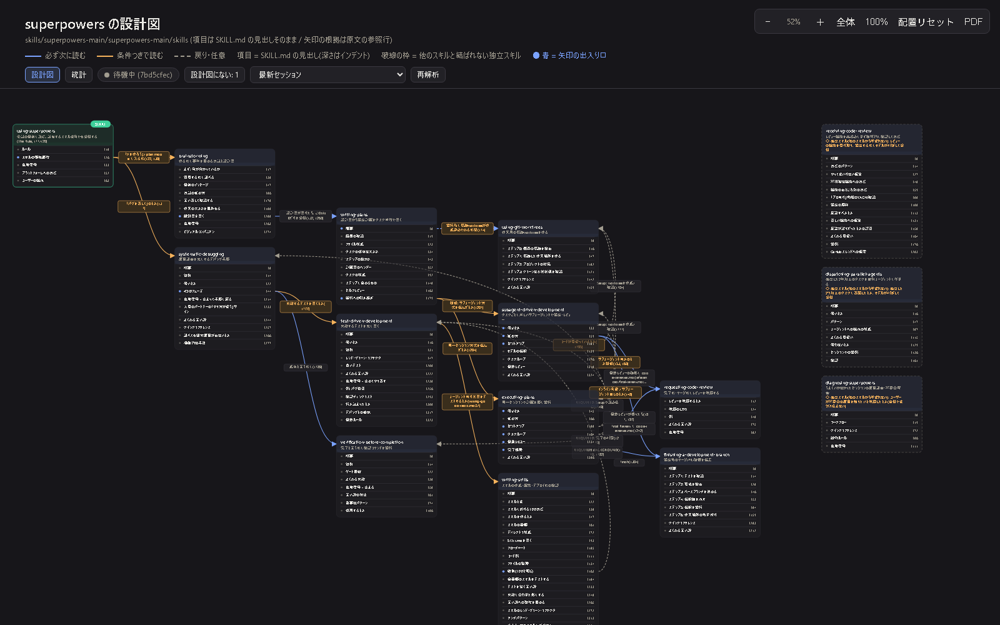

English | [日本語](README.ja.md)

# skill-blueprint

A Claude Code plugin that turns the skills in a `skills/` folder into **a single-page blueprint (HTML)**.

- The skill to read first (START)
- The headings of each skill (taken verbatim from SKILL.md)
- Arrows with condition labels showing when the flow moves on to another skill



## Features

- **Generate a blueprint**: `/skill-blueprint <target> [language] [all|each]`
  - Target: a folder name inside `skills/`, a path, `@project` (`.claude/skills`), or `@user` (`~/.claude/skills`)
  - Scope: **all** (default) puts every skill of the target on one page. **each** makes one page per skill (the relation between SKILL.md and its references)
  - Language: left out, the original text is kept; when given, headings and descriptions are translated into that language (`/skill-blueprint @project Japanese each`).
- **Interaction**: zoom with the mouse wheel, drag cards and arrow labels to move them, and click an item to show the matching lines of SKILL.md in the right panel.
- **PDF export**: use the "PDF" button at the top right of the blueprint and choose "Save as PDF" in the print dialog to get the whole diagram on one page. From the command line: `python -I "<plugin path>/skills/skill-blueprint/scripts/export_pdf.py" blueprints/<folder>` (uses headless Edge / Chrome; output goes to `blueprints/<folder>/blueprint.pdf`).
- **Live run-log overlay**: while the AI uses skills, the current skill pulses and the arrows it has taken get thicker.
- **After-the-fact item estimation and statistics**: once a session ends, the headings that were passed are estimated from the conversation log and colored. The "Stats" view shows pass counts per skill, arrow, and item.

## Installation

```
/plugin marketplace add nabepy/skill-blueprint
/plugin install skill-blueprint@skill-blueprint
```

Requirements: **Python 3.8 or later** (the `python` command; standard library only, nothing else to install).

## Usage

```
/skill-blueprint @project
```

The result is written to `blueprints/<folder>/` in the project root (for `@project` the folder name is `project-skills`).

```
blueprints/<folder>/
  spec.json          the design (for hand edits)
  index.html         the blueprint
  logs/events.jsonl  run log (skill name, time, and session ID only; no conversation text is stored)
  stats.json         analysis result
```

When a blueprint is created, a local server (`127.0.0.1` only) starts in the background and the blueprint opens at the displayed URL (`http://localhost:<port>/index.html`).
The port is fixed per blueprint folder, so blueprints of different projects are never mixed up. The run log is re-read every second.
To control the server manually:

```
python -I "<plugin path>/skills/skill-blueprint/scripts/serve.py" blueprints/<folder> --detach   # start (reuses a running one)
python -I "<plugin path>/skills/skill-blueprint/scripts/serve.py" blueprints/<folder> --stop     # stop
python -I "<plugin path>/skills/skill-blueprint/scripts/serve.py" blueprints/<folder> --status   # status
```

## About the run log

When the plugin is enabled, its bundled hooks run. They append to `logs/events.jsonl` only when a skill listed in
`blueprints/*/spec.json` is used, and write nothing in any other session.

- Only the skill name, time, session ID, and the line range read are saved. Prompts and replies are not saved.
- Passing through an item (heading) is an **estimate** made by reading the conversation log (the file Claude Code saves). The counts for skills and arrows are exact values based on the recorded log.
- To stop recording, disable the plugin.
- If you commit blueprints to a repository, we recommend adding `blueprints/*/logs/` to `.gitignore`.

## License

MIT
